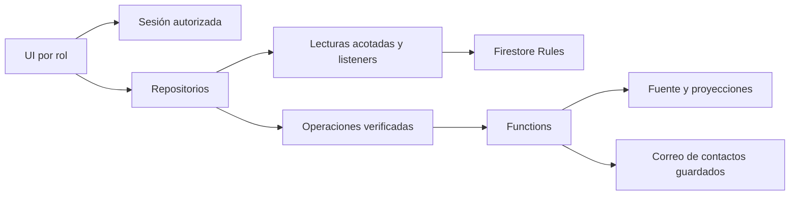

# Contexto operativo del proyecto Lilcare

**Revisión vigente: 10 de octubre de 2026 (P46).** Documento de investigación, no manual final. Sustituye la descripción inicial de este archivo: fuente principal, código local actual; evidencia adicional, pruebas locales registradas en `security/p01/AVANCE_INTEGRACION.md`. No contiene datos personales, secretos ni valores de entorno. Los procedimientos detallados para usuarios están en los cinco contextos funcionales.

- **CONFIRMADO:** verificable en código o pruebas identificadas; no equivale a operación aprobada en producción.
- **APARENTE / REQUIERE VALIDACIÓN:** interpretación o resultado pendiente de comprobar en dispositivo/entorno.
- **NO DETERMINABLE DESDE EL CÓDIGO:** información externa de negocio, soporte o ambiente.

**Estado del entorno:** integración P01 publicada y activada en la ventana D10 autorizada del 10 de octubre de 2026. Veintidós Functions ACTIVE con los cuatro parámetros habilitados; reglas efectivas idénticas a las revisadas; 16 índices READY; cinco cuentas existentes conservadas. Hosting sirve el artefacto revisado en el dominio del consultorio y rutas SPA verificadas. No se crearon cuentas Firebase Auth de Paciente ni se modificaron contraseñas del personal. Ensayo externo con cuentas/SMTP omitido por D09; publicación verificada no equivale a ese ensayo. Irregularidades y deuda, exclusivamente en `PENDIENTES.md`.

## 1. Resumen del producto

Marca **Lilcare**, proyecto/package Angular `pediatrify`. Sistema web de consultorio pediátrico: agenda, expedientes infantiles, antecedentes/vacunas, registros de consulta, recetas/recomendaciones, impresión, colaboradores y administración de cuentas. El portal Paciente representa acceso familiar mediante un expediente infantil, no una cuenta independiente de tutor.

| Rol | Objetivo / entrada normal |
| --- | --- |
| Doctor | Agenda y atención de sus pacientes; Calendario |
| Administrador | Directorios Doctores/Administradores y Bitácora; Doctores |
| Asistente | Agenda del Doctor asociado, alta básica al agendar, disponibilidad; Calendario |
| Paciente | Citas familiares y documentos publicados vigentes; Calendario del portal |

Flujo general: invitación del personal → completar registro → login → operaciones permitidas. Doctor/Asistente crean expediente → correo de acceso → tutor entra por Acceso paciente. Reserva y registro clínico son entidades diferentes; guardar atención no cambia automáticamente la reserva a atendida en el flujo activo. Objetivos comerciales, titular legal y soporte: NO DETERMINABLES.

Fuente en código: `src/app/core/config/brand.ts`, `src/app/app.routes.ts`, `src/app/core/models/user.ts`, `src/app/pages/calendar/`, `src/app/pages/patient-history/`.

## 2. Stack tecnológico

Versiones siguientes: **rangos declarados**, no versiones instaladas exactas. Reproducir con lockfiles del checkout.

| Tecnología | Declaración | Uso |
| --- | --- | --- |
| Angular | Core/common/forms/router ^21.1.0; animations ^21.2.14; CLI/build ^21.1.1 | SPA, standalone, lazy routes, formularios y signals |
| TypeScript | ~5.9.2 frontend; ^6.0.0 Functions | Tipos y compilación |
| Material/CDK | ^21.2.11 | Campos, selectores, datepicker, diálogos/paneles |
| RxJS | ~7.8.0 | Sesión, repositorios/listeners, búsquedas y teardown |
| Firebase JS | ^12.13.0 | Authentication, Firestore, Storage y callables |
| Firebase Admin/Functions | ^13.6.0 / ^7.0.0 | Autoridad y operaciones confiables; Functions v2 |
| Node | Functions exige 24; usado 24.20.0 localmente | Backend/herramientas |
| Nodemailer | ^9.0.1 | SMTP de acceso, invitaciones y recuperación |
| sanitize-html | ^2.18.0 backend | HTML publicado validado/sanitizado |
| Quill | ^2.0.3 | Edición enriquecida de receta/recomendaciones |
| Bootstrap/Popper | ^5.3.3 / ^2.11.8 | Estilos/scripts globales |
| Chart.js/d3-shape | ^4.5.1 / ^3.2.0 | Dependencias gráficas; no atribuir un gráfico a una librería solo por estar instalada |
| Vitest/jsdom | ^4.0.8 / ^27.1.0 | Tests Angular; ejecución actual Vitest 4.1.6 |
| ESLint Functions | ^8.9.0, configuración Google | Lint backend |
| rules-unit-testing | ^5.0.0 en security/p01 | Reglas/emuladores |
| Yarn | yarn@1.22.22 | Frontend; npm en subproyectos |

Hosting Classic sirve SPA; no App Hosting identificado. No NgRx, SSR, PWA/Service Worker ni e2e configurados identificados. No backend adicional a Functions/Firebase. Fuentes/íconos de Google Fonts. `pdf-to-img` ^6.2.0 es una dependencia; no acredita una función visible de exportar PDF.

Fuente en código: `package.json`, `yarn.lock`, `functions/package.json`, `functions/package-lock.json`, `angular.json`, `firebase.json`, `vitest-base.config.ts`.

## 3. Arquitectura del proyecto

| Carpeta | Responsabilidad |
| --- | --- |
| src/app/pages | Pantallas, layouts y diálogos |
| src/app/shared/components | Encabezado/menú, perfiles, tarjetas, confirmaciones, archivos, editor, avisos |
| src/app/core | Firebase, modelos, repositorios, guards, servicios y utilidades |
| public | Marca, ilustraciones y fondos/gráficas |
| functions/src | Acceso, credenciales, operaciones/proyecciones, correo y personal |
| security/p01, p04, p09, p13, p45, p47 | Políticas, pruebas, herramientas confiables/verificación |
| src/environments; functions/src/environments | Configuración privada autorizada; valores omitidos |

Componentes standalone. `authGuard` espera sesión; `roleGuard` limita personal/registro completo; `patientGuard` exige portal autorizado. No interceptors/resolvers identificados. Menús/guards controlan experiencia; backend/Rules verifican autoridad independiente.



| Área → ruta | Componente → servicios/repositorios | Datos |
| --- | --- | --- |
| Agenda → /app/calendar, /paciente/calendario | Calendar/AppointmentDialog/SettingsDialog; Auth, ClinicClock, Patient/Appointment/UserRepository | appointments, appointmentSlots, schedules, directorios |
| Pacientes → /app/patients | Patients; Patient/AppointmentRepository, PatientAccess, Cascade | patients; credenciales privadas por callable |
| Historial → /app/patients/history/:patientId | PatientHistory/ClinicalEntryDialog/GrowthCharts | clinicalRecords, patientDocuments |
| Personal → /app/doctors, /app/admins | Doctors y diálogos; UserRepository, servicios Staff | users, staffDirectory y operaciones privadas |
| Impresión → /app/impresion, /print/:recordId | Impresion/PrintPreview; PrintSettings/User/ClinicalRecordRepository | printSettings, logoPath, registro |
| Portal → /paciente/pacientes y history/:patientId | PatientPatients/PatientHistoryView; gateway/repositorios | familia, patientPortal, publicaciones del servidor |
| Avisos → campana/notificaciones | NotificationService/Repository/NotificationsDialog | notifications por destinatario |
| Bitácora → /app/audit-log | AuditLog/AuditRepository | auditLog |

Fuente en código: `src/app/app.routes.ts`, `src/app/core/guards/`, `src/app/core/services/clinic-gateway.service.ts`, `src/app/core/repositories/`, `functions/src/index.ts`.

## 4. Roles, usuarios y permisos

| Operación | Admin | Doctor | Asistente | Paciente |
| --- | --- | --- | --- | --- |
| Gestionar Doctores/Admins | Sí | No | No | No |
| Invitar Asistente | Solo backend, excepción de pruebas | Sí, propios | No | No |
| Agenda/alta básica | No | Propia | Doctor válido asociado | Familia; sin alta |
| Disponibilidad | No | Sí | Días/segmentos/duración | No |
| Permitir reservas del Paciente | No | Sí | No, ni control visible | No |
| Expediente/clínica/vacunas/gráficas | No | Propios | No | Solo documentos publicados vigentes |
| Contraseña de niño | No | Consultar/copiar/renovar propias | No | No |
| Perfil propio | Solo correo | Profesionales/logo; correo fijo | Nombre/correo | Lectura |
| Bitácora | Sí | No | No | No |

Personal: admin/doctor/assistant. Principal protegido también patient. `SessionUser.type='doctor'` agrupa personal, no convierte a todos en Doctor. Asistente creado por Admin queda asociado a ese Admin para pruebas, sin agenda hasta asociarse a Doctor válido. Baja propia/último Admin bloqueadas en servidor. Recursos requieren propietario/familia/sesión vigente según operación.

Fuente en código: `src/app/core/models/user.ts`, guards, `functions/src/clinic-auth.ts`, `clinic-operations.ts`, `staff-invitations.ts`, `staff-deletion.ts`, `firestore.rules`.

## 5. Navegación y pantallas

| Ruta | Vista / acceso |
| --- | --- |
| /login; /patient-login | Personal; portal por correo/contraseña de expediente |
| /reset-password; /auth-handler | Recuperación/acción de acceso del personal |
| /setup-profile | Invitación validada o personal autorizado incompleto |
| /app | Admin → Doctores; Doctor/Asistente → Calendario |
| /app/calendar | Doctor/Asistente |
| /app/patients; /app/patients/history/:patientId | Doctor; historial de propietario |
| /app/doctors | Admin: Doctores; Doctor: Asistentes |
| /app/admins | Exclusivo Admin; mismo patrón de directorio |
| /app/impresion | Doctor |
| /app/perfil; /app/notificaciones | Páginas mobile de personal; Admin sin campana/destinatario de citas |
| /app/audit-log | Admin |
| /paciente | → calendario del portal |
| /paciente/calendario | Citas familiares y ocupación sin identidad de otros niños |
| /paciente/pacientes; /paciente/pacientes/history/:patientId | Familia del mismo correo/Doctor; documentos vigentes |
| /paciente/perfil; /paciente/notificaciones | Páginas mobile del portal |
| /print/:recordId | Doctor propietario; impresión clínica |
| /patients; /doctors | Redirecciones a áreas protegidas |
| Raíz/desconocida | Login personal |

Ruta histórica de inicialización redirige a Login, sin aprovisionar Admin. Doctor: Calendario/Pacientes/Asistentes/Impresión. Admin: Doctores/Administradores/Bitácora. Asistente sin barra principal de áreas. Diálogos, acciones/modal/mobile: inventarios de los cuatro contextos por rol.

Fuente en código: `src/app/app.routes.ts`, `src/app/shared/components/sidebar/`, `header/`, `src/app/pages/doctor-layout/`, `patient-layout/`.

## 6. Flujos operativos

Pasos, campos, validaciones, mensajes, finales y variantes completos: [Doctor](DOCTOR_OPERATIONS_CONTEXT.md), [Administrador](ADMIN_OPERATIONS_CONTEXT.md), [Paciente](PATIENT_OPERATIONS_CONTEXT.md), [Asistente](ASSISTANT_OPERATIONS_CONTEXT.md).

| Entrada → pasos | Persistencia / resultado |
| --- | --- |
| Login → contraseña → sesión protegida | UID/contraseña conservados; incompleto → completar registro; fallo no concede acceso |
| Invitación → nombre/correo → enlace → registro | Pendiente/reserva; un uso/siete días; reenviar reemplaza enlace; reintentar entrega no crea cuenta |
| Alta niño → campos → confirmaciones → crear → correo | Expediente/credencial/proyecciones/recibo; ambos contactos; fallo parcial conserva alta/reintento |
| Perfil niño → antecedentes/contacto/vacunas → guardar | Doctor; nacimiento no futuro, medidas positivas y campos condicionales |
| Historial → Datos por consulta → guardar/imprimir | Registro distinto de cita; motivo/diagnóstico/medidas/publicaciones; popup bloqueado puede impedir guardar/imprimir |
| Agendar → seleccionar paciente → día/hora → confirmar | Selección real; historial fija paciente; personal confirma superposición, portal bloquea otra cita vigente |
| Cita → Reagendar/Cancelar | Misma identidad; propia excluida de ocupación; cancelar libera slot; portal necesita habilitación también para cancelar |
| Configuración → segmentos/duración → guardar | Semana completa validada; semana cerrada admitida; Asistente no modifica habilitación |
| Perfil propio → guardar | Campos por rol; correo propio modificado vuelve a Login con contraseña actual |
| Directorio → editar/eliminar/invitar | Servidor autorizado/retomable; confirma baja; Admin propio/último bloqueados |
| Campana → filtro/scroll → lectura/detalles | Por destinatario; abrir no lee todo; detalles enfoca Calendario; cerrar marca cancelaciones |

Fuente en código: componentes citados en contextos; `functions/src/clinic-operations.ts`, `clinic-patients.ts`, `clinic-mail.ts`, módulos staff.

## 7. Modelo de datos

### Fuentes de negocio

| Colección / ID | Campos principales / tipos | Relaciones / operaciones |
| --- | --- | --- |
| users / UID negocio | uid/email/name/role, firebaseUid, pending/profileComplete, sexo numérico, phone/especialidad/cedula/cedulaEspecialidad/consultorios/logoPath, agenda/printSettings, createdBy, Timestamp creación/actualización | Auth por firebaseUid; Asistente createdBy propietario. Servidor crea/actualiza/baja; SDK lee propio |
| patients / expediente | id/doctorId/name/lastName, birthDate string civil, email/secondaryEmail, fatherName/motherName, phone/secondaryPhone/referredBy/profileComplete, sangre/medidas/nacimiento, antecedentes boolean+texto, vaccinationRecord, timestamps | Doctor fuente completa; alta Doctor/Asistente, edición/baja Doctor; sin contraseña en fuente pública nueva |
| clinicalRecords / consulta | patientId/doctorId/date, weight/height/headCircumference/bmi/saturation/temperature, motivoConsulta/diagnosis/notas, recommendations/prescription HTML, visibleUntil/visibleUntilRx, createdBy/updatedBy/timestamps | Solo Doctor; creación original conservada al editar; baja expediente elimina |
| appointments / cita | patientId/doctorId, snapshots nombre/contacto/nacimiento/Doctor, date/time strings, status/type/notes, timestamps/updatedBy/disabled | scheduled/attended/cancelled; scheduled/walk-in en modelo. Flujo activo agenda/reagenda/cancela. Equipo agenda; portal familia |
| notifications / evento-destinatario | id/type/title/description/appointmentId?/doctorId/createdAt/originatorId/Name/recipientId/recipientType/read | Servidor genera; receptor marca read=true. Sin array compartido de recipients en persistencia actual |
| auditLog / operación | action/entityType/entityId/performedBy/performedByUid/timestamp/oldValues/newValues? | Servidor escribe; Admin lee; baja de personal conserva |

### Proyecciones de lectura

| Colección | Contenido / lectores |
| --- | --- |
| staffDirectory | Identidad/rol/estado/asociación mínima; Admin Doctores/Admins; Doctor sus Asistentes |
| doctorProfiles; schedules | Profesional/logo/impresión y configuración de agenda; equipo/portal de ese Doctor |
| patientDirectory | Identidad/contacto básico/pertenencia; equipo sin antecedentes |
| patientPortal | Resumen mínimo; get de familia, no listado universal |
| patientDocuments / registro-tipo | Publicación/vigencia; SDK denegado, servidor contrasta fuente al devolver |
| appointmentSlots / cita | Solo id/doctorId/date/time; ocupación sin identidad; cancelar/disabled elimina |
| familyAccess / ID interno de sesión / patients / expediente | patientId/doctorId; servidor materializa y contrasta contacto vigente; no es identidad Firebase Auth de Paciente |
| patientSessionStatus / expediente | Proyección privada de estado/época/revisión; no lectura SDK del Paciente |

### Datos técnicos privados

| Grupo | Propósito / operaciones |
| --- | --- |
| securityPrincipals; clinicSessions | Personal: AuthUID/rol/propietario y lease firmado. Paciente: ID interno aleatorio y hash de sesión opaca, sin cuenta Auth. Metadata SDK propia solo personal; servidor/operador escribe |
| patientCredentials; patientPasswordReservations | Contexto/revisión/época/contactos, scrypt/copia cifrada y huella de exclusividad activa; nunca SDK ni valores en docs |
| patientCreationOperations; patientCredentialOperations; clinicOperations | Recibos/reintentos sin duplicar; servidor |
| patientDeletionJobs; staffDeletionJobs | Barrera y cascada retomable/completada; servidor |
| staffInvitations; staffInvitationTokens; staffInvitationIssueJobs | Invitación/hash/plazo/uso/retirada; sin tokens vigentes en docs |
| staffEmailReservations; staffEmailChangeJobs | Exclusividad y cambio retomable Auth/perfil |
| clinicEmailDeliveries | Estado por destino/lease de envío/barrera de repetición |
| Rate limits y emailCounter/daily | Presupuestos privados de login/invitación/recuperación/correo; módulos correspondientes |

No editables desde UI; solo campos/responsabilidades principales, no esquema criptográfico exhaustivo. Retención conserva clínica/audit/credenciales/reservas vigentes y barreras necesarias.

Fechas civiles YYYY-MM-DD, horas HH:mm, zona consultorio America/Mexico_City. Date local de Material representa día elegido, no medianoche UTC. Instantes de creación/actualización Timestamp; gateway reconstruye serialización de callables. Orden clínico: día consulta descendente, creación original con nanosegundos, ID estable. Vigencia incluye último día; blanco significa sin límite en lectura; formularios activos piden fecha de publicación.

Fuente en código: `src/app/core/models/`, `functions/src/clinic-data.ts`, `clinic-operations.ts`, `clinic-auth.ts`, `patient-credentials.ts`, repositorios, `src/app/core/utils/date-utils.ts`, `clinic-time.ts`, `clinical-record-order.ts`.

## 8. Firebase Authentication

Personal email/password Firebase → sesión protegida/token personalizado ligado a UID existente, autoridad y lease por dispositivo. Paciente: correo/código reutilizable verificados en servidor → sesión opaca exclusivamente en memoria del servicio. No se crea ni inicia identidad Firebase Authentication del Paciente. El portal consulta, escucha y modifica datos mediante `patientPortal`; no accede directamente a Firestore. Sin proveedor social ni autorregistro público de tutor identificados.

Invitación crea/completa personal controladamente; Admin crea Doctor/Admin, Doctor o Admin Asistente en backend. Perfil negocio y Auth vinculados por firebaseUid; no autoasignar rol por correo en navegador. Recuperación personal responde genéricamente conocido/desconocido y solo genera enlace para cuenta autorizada. Cambio de correo de personal actualiza Auth/perfil conservando contraseña/asociaciones; no es solo Firestore. Contactos de paciente son alias del expediente.

El ID del documento del personal puede conservar punto/@/+ de un directorio existente: es únicamente un segmento de documento acotado, no una búsqueda o concesión de rol por correo. El UID Firebase sigue siendo una identidad distinta vinculada mediante `firebaseUid`. IDs de operaciones, pacientes, citas y sesiones mantienen validación independiente estricta. La herramienta de operador prepara la normalización explícita de `uid` contra el documento conservado, sin mover relaciones ni recrear Auth.

Cuatro roles: máximo una hora inactiva y servidor exige lease vigente. Personal conserva plazo al recargar/reanudar. Paciente no guarda sesión, código ni actividad en cookies/localStorage/sessionStorage: recargar/cerrar pestaña exige entrar de nuevo. Volver a una pestaña abierta conserva plazo restante. Listeners de servidor validan sesión/revisión y transmiten cambios sin renovar actividad; se retiran al salir/desconectar. Paciente sale a /patient-login, personal a /login; logout no caduca código. Renovación del Doctor invalida accesos anteriores del expediente.

Fuente en código: `src/app/core/services/auth.service.ts`, `functions/src/clinic-auth.ts`, `clinic-identifiers.ts`, `clinic-sessions.ts`, `clinic-leases.ts`, `clinic-recovery.ts`, `staff-email-change.ts`, `staff-invitations.ts`.

## 9. Firebase Storage

Uso: logos personalizados. PNG/JPG/JPEG/SVG no vacío hasta 1 MiB. Nuevo objeto `logos/{DoctorUID}/{UUID}_{nombreArchivo}`; perfil/Impresión preview local, upload al guardar; cancelar antes de subida no escribe. Reintento reutiliza subida confirmada y no sobrescribe objeto anterior. Invitación pública no sube; Doctor añade desde Perfil.

Get público por enlace, list denegado; mutaciones solo Doctor propietario con autoridad/lease vigentes. Retirar/reemplazar confirma logoPath/ajustes; objetos sin referencias se revisan/limpian manualmente D07. Baja Doctor elimina logos de propietario. No contenido de paciente en este flujo de marca.

Fuente en código: `src/app/shared/components/file-upload/`, `profile-dialog/`, `src/app/pages/impresion/`, `src/app/core/utils/logo-utils.ts`, `storage.rules`, `functions/src/staff-deletion.ts`, `security/p01/prepare-maintenance.mjs`.

## 10. Firestore Rules / Storage Rules

Reglas raíz actuales: negación por defecto. Clínica Doctor propietario; Asistente directorio básico/agenda; Admin personal/Bitácora. Paciente no tiene permisos SDK, incluso con una identidad Firebase histórica o fabricada: portal, citas, ocupación, avisos y metadata pasan por servidor. Personal requiere autoridad/asociación/Doctor/lease según recurso. Escrituras SDK de negocio denegadas excepto read=true del aviso propio del personal con esquema válido. Servidor revalida código/revisión/contacto/Doctor/familia/lease para cada acceso del portal.

Functions Admin SDK verifica operaciones independientemente de Rules. Fuente/proyecciones se escriben desde servidor. Storage get público de logos, mutación Doctor propietario y límites de formato/tamaño, dos lecturas Firestore. Configuración de mantenimiento separada niega Firestore SDK y mutaciones/listado Storage conservando enlaces de logo.

**CONFIRMADO en código/pruebas locales; contenido efectivo desplegado comparado durante D10.** La comparación comprueba igualdad de las reglas, sin sustituir el ensayo externo omitido. Auditoría `security/p01/audit-integration.json`; inspección histórica remota/prototipo separada. Fuente en código: `firestore.rules`, `storage.rules`, `functions/src/clinic-auth.ts`, `clinic-operations.ts`, pruebas de integración Rules/Storage y `security/p01/maintenance.*.rules`.

## 11. Calendario y citas

Semana completa comienza domingo. Fecha/navegación/detalle; desktop grilla, mobile día/lista/tarjetas/detalle inferior. Sin dashboard separado. Equipo agenda del Doctor; portal familia y ocupación anónima. Asistente exige Doctor autorizado completo/no pendiente; error de asociación ofrece Reintentar/Cerrar sesión, sin agenda/configuración.

### Cómo se decide el día/hora

1. Normalizar mapa semanal/duración; conservar semana cerrada explícita.
2. Generar inicios por duración dentro de cada segmento; la consulta debe caber completa.
3. Rechazar pasado/cerrado; hoy solo inicios posteriores al minuto del centro de México, independientemente de dispositivo.
4. Portal requiere habilitación y elimina horarios de otras citas vigentes; canceladas/disabled liberan ocupación.
5. Editar excluye solo ID propio. Fecha/hora original sin cambios puede conservarse fuera de disponibilidad actual; otra vigente bloquea al portal.
6. Cambiar Día conserva Hora solo si válida, en otro caso limpia. Guardar verifica de nuevo tiempo/estado.
7. Personal acepta superposición con advertencia; portal no. P22 conserva realtime/comprobaciones sin reserva atómica de slots.

Ejemplo abstracto: duración 30, segmento 09:00–10:00 ofrece 09:00/09:30; hoy después de 09:00 solo 09:30. Sin segmento o espacio para duración no hay slot nuevo. No festivos/excepciones por fecha ni duración individual confirmados.

Paciente debe seleccionarse de resultado real; texto diferente retira selección. Historial lo fija; calendario busca/crea. Alta embebida reemplaza contenido del panel, no confirma cita. Editar mantiene paciente. Cancelar confirma/estado cancelado/avisos y libera slot. Deshabilitar reservas también impide reagenda/cancelación del Paciente.

Fuente en código: `src/app/pages/calendar/`, `dialogs/appointment-dialog/`, `src/app/core/utils/availability.ts`, `clinic-time.ts`, `src/app/core/repositories/appointment.repository.ts`, `functions/src/clinic-operations.ts`.

## 12. Configuración de horarios

Fuente users: consultationDuration/allowPatientScheduling/timeSegmentsByDay/availableDays; campos globales timeSegments/startTime/endTime para compatibilidad de lectura. Servidor genera schedules/doctorProfiles. Etiquetas Lun/Mar/Mié/Jue/Vie/Sáb/Dom.

Formulario tiene duración/habilitación y FormArray del día activo; signal guarda mapa completo. Cambiar día sincroniza activos y crea controles nuevos. Entrada clona arrays/objetos, sin compartir mutables entre días. Guardado valida toda semana: HH:mm completo/válido, inicio antes de fin, no superposición; duración positiva. Intacto/inválido/en curso bloqueado.

Día vacío cerrado; toda semana vacía guarda/aplica/reabre sin defaults. Global antiguo se reparte solo cuando corresponde a formato compatible, no para reabrir cierre explícito. Asistente edita días/segmentos/duración, oculta/deshabilita habilitación y omite campo al guardar; servidor rechaza introducirlo. Doctor sí lo edita.

Fuente en código: `src/app/pages/calendar/dialogs/settings-dialog/`, `src/app/core/utils/availability.ts`, `src/app/pages/calendar/p25-closed-week.spec.ts`, `functions/src/clinic-data.ts`, `clinic-operations.ts`.

## 13. Pacientes

Doctor listado propio/consultas programadas del día; busca niño/tutores. Alta nombre/nacimiento no futuro/correo/ambos tutores/teléfono diez dígitos; secundario opcional. Correo/nombre coincidente exigen aceptaciones independientes; cambiarlos reinicia aceptación. Hermanos permitidos tras confirmar. Reintento incierto no duplica.

Completar tres pasos antecedentes/medidas/contactos/vacunas; exige ambos tutores. Edición exige al menos uno; correo/teléfono principal obligatorios, medidas positivas decimales, PC al nacer opcional (null al retirar). No máximos médicos inventados. Historial incluye registros/medidas/motivo/diagnóstico/notas/documentos/gráficas; portal solo publicaciones vigentes. Padres no son cuentas independientes. Citas relacionan patientId+doctorId con snapshots.

Baja confirmada Doctor elimina expediente/clínica/citas/publicaciones/credencial y revoca acceso; conserva auditoría. Fuente en código: `src/app/pages/patients/`, `patient-history/`, `patient-patients/`, `functions/src/clinic-patients.ts`, `clinic-patient-deletion.ts`.

## 14. Esquema de vacunación

Mapa vacuna→edad→dosis applied boolean; modelo opcionales applicationDate/batchNumber/institution/notes; UI principalmente marca/desmarca. Catálogo: BCG, Hepatitis B, Hexavalente, DPaT, rotavirus mono/pentavalente, neumococo conjugada/polisacáridos, influenza, Covid-19 ARNm, SRP, varicela, Hepatitis A, meningococo ACYW. Edades exactas en contexto Doctor y constantes de formularios.

Desktop tabla/scroll/columna Vacuna fija; mobile filas por vacuna/dosis. Lectura deshabilitada, edición borrador, guardar perfil persiste. Cruces sin dosis no operables; sin obligación de marcas. Anual es una casilla, no años de aplicaciones. Sin inputs activos de lote/fecha/aplicador ni recordatorios identificados. **Confirmación externa del 10 de octubre de 2026:** el usuario comunica que el Doctor confirma las curvas de crecimiento y el esquema de vacunación actuales; P37/D11 cerrado. No se indicó una referencia bibliográfica concreta ni se realizó una certificación clínica independiente del agente.

Fuente en código: `src/app/core/models/user.ts`, `src/app/pages/patients/dialogs/complete-profile-dialog/`, `edit-patient-dialog/`.

## 15. Impresión

| Entrada | Documento / fuente |
| --- | --- |
| Guardar e imprimir | Guarda contexto validado y abre impresión clínica; reserva popup cuando corresponde |
| /print/:recordId | Doctor propietario; registro/paciente/perfil/ajustes; retira DOM al perder autorización |
| Historial → imprimir sección | Receta/recomendaciones con datos/logo/ajustes Doctor |
| Gráficas → imprimir | Gráfica/mediciones y configuración según flujo |
| Portal → publicación | Carta vertical, 2.5 cm, contenido seleccionado vigente sin logo/encabezado profesional |

No PDFs en Storage generados por esos flujos. Ventanas nuevas/diálogo de navegador; guardar PDF depende del navegador, no exportación garantizada. Popup bloqueado muestra instrucción; puede impedir guardar/imprimir.

users.printSettings: Media carta 21.5×14, Carta 28×21.5, Oficio 33×21.5 o personalizado; vertical intercambia dimensiones; márgenes cm; logo 3/5 cm/posición; flags de datos profesionales/paciente. Defaults media carta horizontal/márgenes 1 cm/logo 5 cm/flags activos. Preview abstracto; cédulas en un renglón. PrintPreview clona DOM/usa @page en ventana nueva para saltos; impresión física/paginación requiere validar navegador/impresora.

Fuente en código: `src/app/pages/print-preview/`, `patient-history/patient-history.ts`, `components/growth-charts/`, `patient-history-view/`, `impresion/`, `src/app/core/models/print-settings.ts`.

## 16. Logo del Doctor

Fuente actual users.logoPath/proyección doctorProfiles. Perfil/Impresión confirman mismo campo; URL resuelta/filename/previews son estado local. Valores antiguos tolerados al resolver no se migran automáticamente. PrintSettings no define segundo archivo, sus flags gobiernan presentación.

- Header: Doctor propio; Asistente/Paciente heredan Doctor; Admin marca; fallback /images/Logo.jpg.
- Perfil permite elegir/reemplazar/retirar; invitación pública no sube. Setup autenticado existente conserva su flujo.
- usePreloadedLogo=true utiliza marca Lilcare; false logo Doctor o marca si falta. Retirar vuelve a marca.
- Archivo nuevo UUID evita sobrescritura; eliminar referencia no limpia indiscriminadamente huérfanos. D07 reporte/revisión manual.
- Logos públicos por enlace D06; no datos de paciente en marca.

Fuente en código: `src/app/core/config/brand.ts`, `core/utils/logo-utils.ts`, `shared/components/header/`, `profile-dialog/`, `file-upload/`, `pages/impresion/`, `setup-profile/`, `functions/src/clinic-data.ts`. Rutas abreviadas relativas a src/app.

## 17. Design system

| Elemento | Patrón |
| --- | --- |
| Primary | #0D6E8F/blanco/radio12/padding16×24/Roboto500 16/24/sin elevación |
| Secondary/tertiary | Transparente/texto primario; secondary borde1, tertiary sin borde; mismas dimensiones |
| Danger | #B3261E, patrón primary |
| Chip | Radio8/padding6×16/borde primario/Roboto500 14/20; activo fondo primario/blanco/check |
| Alerts | Éxito #BFEDFA/error #F9DEDC; hasta cinco/timer/cierre individual/inferior centrado |
| Input/dialog | Material outline/etiquetas opcional/errores instructivos; right-panel/context-card-panel/notif-panel |

.w-100-mobile ≤768 px. Roboto/espaciado global y por componente; no catálogo central completo de tokens identificado. Fuente en código: `src/styles.scss`, `shared/components/alert-overlay/`, `core/services/alert.service.ts` y SCSS de pantallas.

## 18. Responsive behavior

Breakpoint principal ≤768 px; ajustes particulares por componente. No categoría Tablet uniforme para todas las áreas.

| Área | Desktop/tablet ancho | Mobile |
| --- | --- | --- |
| Doctor/Admin | Navegación lateral | Inferior/compacta según layout |
| Asistente | Sin sidebar | Sin barra principal de áreas |
| Calendario | Semana/grilla/detalle | Día/lista/detalle inferior; reagenda inferior |
| Formularios | Drawer derecho | Panel inferior; filas pueden envolver, no todo una columna |
| Perfil personal | Diálogo | Página lectura/editor inferior |
| Perfil Paciente | Diálogo lectura | Página sin editor |
| Avisos | Ventana superior derecha/scroll interno | Página completa |
| Vacunas | Tabla/scroll/columna fija | Filas vacuna/dosis |
| Impresión | Preview junto a controles | Preview tab/editor inferior |
| Login | Botones fila | Apilados/ancho disponible |

Checklists separadas de capturas en cinco contextos; ninguna capturada. Fuente en código: `src/styles.scss`, SCSS sidebar/calendar/dialogs, `header.ts`, `impresion.ts`, `notification-bell.ts`.

## 19. Notificaciones

appointment-created/cancelled/rescheduled, generadas por servidor con operación/por destinatario. Actor leído, demás sin leer; Doctor+Asistentes+familia del mismo Doctor; Admin excluido. Conteo backend independiente de páginas, caches/filtros/cursores/realtime/carga incremental.

Abrir/filtrar/scroll no lee todo; Ver detalles marca y enfoca Calendario, canceladas sin enlace y eliminadas/disabled lo pierden. Marcar todas sin confirmación; cerrar/abandonar marca cancelaciones. Skeleton/spinner/vacío/sin no leídas/final/error. Sin recordatorio/push identificado. SDK no crea avisos ni cambia texto/destinatario.

Fuente en código: `functions/src/clinic-operations.ts`, `core/services/notification.service.ts`, `core/repositories/notification.repository.ts`, `shared/components/notifications-dialog/`, `notification-bell/`, `firestore.rules`.

## 20. Estado y sincronización

Auth publica sesión observable/signals; gateway principal/lease/familia/scope$. Personal usa listeners SDK acotados. Paciente usa llamadas y streaming de `patientPortal`; los `onSnapshot` están en servidor y sus respuestas se autorizan antes de transmitir. Scope/AbortController retiran resultados/conexiones previas; respuestas de otra sesión se descartan. Calendario refresca citas/ocupación sin persistir sesión del Paciente. ClinicClock minuto/focus/visibility actualiza límites. Otras pantallas combinan lectura puntual/listener; no afirmar realtime universal.

P47: 46 HTML externos/cinco inline/dos host bindings sin presentación mediante campos/métodos ordinarios. Signals/computed/input/contentChild/toSignal; eventos/formularios/locales legítimos conservados. Etiquetas/edades/opciones/estados de gráficas derivados no se envían como nuevos campos de negocio. Recibos conservan identidad de petición incierta y servidor evita duplicados. Fuentes/proyecciones tienen responsabilidad distinta, se escriben desde servidor.

Fuente en código: `core/services/auth.service.ts`, `clinic-gateway.service.ts`, `clinic-clock.service.ts`, repositorios, `security/p47/template-audit.mjs`, `functions/src/clinic-operations.ts`.

## 21. Manejo de errores

Credenciales genéricas; recuperación no revela cuentas. Formularios errores instructivos/guardar bloqueado inválido/intacto/en curso. Alerts/snackbars/estados por pantalla. Niño creado y correo entregado son resultados distintos: fallo parcial no revierte alta, reintento sin duplicar. Asistente asociación inválida Reintentar/Cerrar sesión; popup instruye permitir ventanas. Pérdida de autoridad/lease retira sesión/contenido, caches no conceden permiso. Servicio apagado rechaza, no éxito ficticio. Vacíos/errores/botones concretos en contextos por rol.

Fuente en código: `core/services/alert.service.ts`, `auth.service.ts`, componentes citados por rol, `functions/src/clinic-auth.ts`, `clinic-mail.ts`.

## 22. Tests

Angular después de P47/revisión D10 **886/886 en 73 archivos**: sesión/idle/guards/repositorios/UI, calendarios/horarios, portal/publicaciones, logo/impresión, personal/Admin, IDs conservados y gráficas/edad reactivas. Vitest isolate=true/maxWorkers6. No coverage porcentual obtenido ni e2e configurado identificado.

Node **269/269**. Emulador por grupos: portal **9/9**, reglas **19/19**, credenciales **22/22**, operaciones **23/23**, autoridad/login **11/11**, Storage **5/5**, bajas Admin **3/3**, rotación **3/3**, mantenimiento **2/2**. Operaciones repetidas tras ajustar la firma de un fixture; otros ocho grupos aprobados en la ejecución conjunta. No presentar como una única ejecución integral, coverage ni ensayo desplegado. Datos sintéticos, SMTP/personal simulados. Functions build/lint y Angular producción aprobados. P47: node security/p47/template-audit.mjs.

Comandos y alcance en `security/p01/AVANCE_INTEGRACION.md`; `angular.json`, `vitest-base.config.ts`, subproyectos security. Ensayo externo omitido D09.

## 23. Ejecución local

1. Node24/Yarn1.22.22; Java21 para emuladores comprobados.
2. Frontend yarn install --frozen-lockfile; backend npm --prefix functions ci; reglas npm --prefix security/p01 install con lockfile de ese subproyecto.
3. Configuración autorizada privada src/environments/environment.ts export environment.firebase. Campos SDK necesarios según ambiente: apiKey/authDomain/projectId/storageBucket/messagingSenderId/appId; solo nombres, valores omitidos. No fileReplacements declarados en angular.json.
4. Backend privado functions/src/environments/environment-functions.ts export environments.smtp conforme Nodemailer: host/port/secure/auth.user/auth.pass. Secretos/parámetros por runbook, nunca incrustados en frontend.
5. yarn start (normalmente4200) y acceso al backend habilitado correspondiente. FirebaseService no conecta automáticamente a emuladores; iniciar Functions emulator no redirige app.

```powershell
yarn start
yarn build
yarn test --watch=false
npm --prefix functions run build
npm --prefix functions run lint
node security/p47/template-audit.mjs
```

No target lint Angular. Secretos: PATIENT_CREDENTIAL_ENCRYPTION_KEY/PATIENT_PASSWORD_UNIQUENESS_KEY/PATIENT_LOGIN_LIMITER_KEY. Flags: CLINIC_SECURITY_ENABLED/STAFF_INVITATIONS_ENABLED/STAFF_EMAIL_CHANGE_ENABLED/STAFF_DELETION_ENABLED, false por defecto. No valores de claves/SMTP/ADC. P01_PREVIOUS/NEXT_ENCRYPTION/UNIQUENESS_KEY son variables de rotación fuera de servicio, no ejecución habitual.

Pruebas firebase.p01.emulators.json/demo-lilcare-p01/Firestore8187/Storage9199; comandos AVANCE_INTEGRACION. Operadores ADC/proyecto/base explícitos; sin bootstrap de autoridad UI.

Fuente en código: `package.json`, `functions/package.json`, `angular.json`, `core/firebase/firebase.service.ts`, `functions/src/clinic-mail.ts`, `firebase.p01.emulators.json`, `security/p01/ACTIVACION_COORDINADA.md`.

## 24. Ambientes

Build development/production, Functions Node24 y Firebase por configuración autorizada. Prueba demo local no es producción. Base objetivo preparada (default), Native/Standard; metadatos históricos de entorno en P01. No separación efectiva dev/staging/prod/pipeline de aliases confirmada. Gateway región us-central1. Build production no certifica qué Firebase consumirá: depende del environment autorizado.

Fuente en código: `angular.json`, `firebase.json`, `firebase.p01.emulators.json`, `core/services/clinic-gateway.service.ts`, `security/p01/remote-inspection.json`, runbook.

## 25. Deploy

Scripts: yarn send = build production && firebase deploy; yarn sendf/Functions deploy publican Functions. firebase.json: Hosting dist/pediatrify/browser/rewrite SPA, Rules/índices Firestore, Storage Rules, Functions/default y predeploy lint/build. Comandos manuales; CI/CD no confirmado.

Integración actual requiere **ventana coordinada** `security/p01/ACTIVACION_COORDINADA.md`: preparar artefacto/índices/autoridad revisable → página/reglas cerradas → Functions compatibles flagsfalse → drenar → aplicar autoridad → Rules definitivas → habilitar conjunto → Hosting final → verificar metadatos. firebase.p01.maintenance.json separado. Fallo: conservar ventana/reparar versión compatible, no Rules permisivas ni frontend viejo aislado. D10 publicado y activado tras autorización de la ventana; fases A-G completadas y verificadas por componente. Ensayo externo omitido por D09. Logs: npm --prefix functions run logs/Firebase/Cloud Logging; sin PII/tokens en reportes.

Fuente en código: `firebase.json`, `firebase.p01.maintenance.json`, scripts package, `security/p01/ACTIVACION_COORDINADA.md`.

## 26. Operaciones y mantenimiento

| Tarea | Procedimiento |
| --- | --- |
| Preservar personal/autoridad | prepare-staff-authority.mjs; ADC/plan revisado/huellas frescas/Admin operacional; conserva UID/contraseña, sin auto-rol |
| Personal | UI/servidor retomable; no sustitución por edición parcial Auth/users |
| Acceso niño | Doctor consulta/copia/renueva; ambos contactos; Asistente reintenta su alta sin contraseña |
| Logos | prepare-maintenance.mjs: reporte/revisión manual/writers stopped/referencia/generación; no cron |
| Retención | 30 días técnicos selectivos; conserva clínica/audit/credenciales/reservas/barreras. Sesiones opacas de Paciente elegibles sin operaciones Auth; limpieza de identidad Auth histórica solo si corresponde al formato anterior, nunca personal |
| Claves | prepare-credential-key-rotation.mjs fuera de servicio/plan revisado; mismo plan para reanudar, preserva contraseña/verificador/época/revisión/reserva+cifrado; no publicar secretos antes de completar |
| Clínica | P37/D11 cerrado por confirmación del Doctor comunicada por el usuario; conservar curvas y esquema actuales. Tests de software no equivalen a validación clínica. |
| Diagnóstico | Logs/recibos/estado antes de repetir baja/envío; no pegar información privada |

Sin migrar/recuperar datos de negocio antiguos por decisión; tampoco borrado indiscriminado autorizado. Planes privados review-plans ignorados; herramientas preparadas, no ejecutadas contra Firebase. Retención30d operativa, no afirmación legal. Fuente en código: `security/p01/prepare-*.mjs`, `operator-policy.mjs`, `credential-key-policy.mjs`, backend.

## 27. Troubleshooting

| Problema | Síntoma | Posible causa | Diagnóstico | Sistemas |
| --- | --- | --- | --- | --- |
| Servicio apagado | Rechazo/sin guardar | Flagfalse/activación incompleta | Versión/flags del conjunto; mantener ventana | Functions/runbook |
| Sesión vencida | Retorno login | Idle/lease/autoridad | Metadata propia/plazos/login; no revivir cache | Auth/principal/lease |
| Agenda Asistente | Reintentar/Cerrar sesión | Doctor inválido/pendiente/fallo lectura | Asociación/Doctor autorizado; retry no reasigna | Calendar/createdBy |
| Hora ausente | Selector sin slot | Cerrado/pasada/duración/ocupada/permiso | Mapa/horaMéxico/citas vigentes | Availability/schedules/slots |
| Niño no elegido | Agendar bloqueado | Texto no seleccionado | Elegir resultado real | AppointmentDialog |
| Correo parcial | Alta confirmada/contacto pendiente | SMTP/respuesta incierta | Estado/reintento original, no nueva alta | Mail/recibos |
| Invitación inválida | Registro bloqueado | Usada/expirada/reemplazada | Reenviar pendiente, no enlace viejo | staffInvitations |
| Sin publicación | Empty state | Sin contenido/vencimiento/familia distinta | Fuente/fechaMéxico/contacto/Doctor | getClinicPublications |
| Logo | Fallback/sin imagen | Referencia/archivo/resolución | logoPath confirmado/Storage; no copiar tokens | Header/logo-utils |
| No impresión | Popup alert | Bloqueo navegador | Permitir ventanas/repetir flujo | PrintPreview/history |
| Query | Carga/error | Índice o permiso/scope | Índices listos/consulta autorizada; no ampliar Rules | Firestore/repositorios |

Diagnóstico respaldado, no soluciones que alteren datos sin autorización.

## 28. Riesgos y deuda técnica

Registro único: **[PENDIENTES.md](PENDIENTES.md)**; ahí clasificación CONFIRMADO/POSIBLE, evidencia/resolución/activación. No reproducir hallazgos en manuales. No significa certificación del entorno ni cierre de evidencia externa.

## 29. Glosario

| Negocio | Código / significado |
| --- | --- |
| Doctor/Admin/Asistente | AppUser.role; permisos distintos |
| Paciente/familia | Patient infantil y sesión patient dentro del mismo Doctor/correo |
| Consulta/cita | Appointment reserva; distinta de ClinicalRecord |
| Datos por consulta | Registro clínico |
| Segmento | TimeSegment startTime/endTime de día semanal |
| Día cerrado | Sin segmentos |
| OTP | Denominación histórica de contraseña generada reutilizable |
| Visible hasta | Vigencia inclusiva/independiente por publicación |
| Logo precargado | Marca Lilcare/usePreloadedLogo |
| Principal/lease | Autoridad confiable y sesión temporal, no menú/cache |
| Proyección/recibo | Datos mínimos derivados / reintento sin duplicar |

## 30. Inventario de archivos clave

| Área | Archivos (abreviados relativos a src/app donde corresponda) | Responsabilidad |
| --- | --- | --- |
| Arranque | src/main.ts, app.config.ts, app.routes.ts | SPA/proveedores/rutas |
| Acceso | core/services/auth.service.ts, clinic-gateway.service.ts, core/guards/ | Sesión/scope/callables/navegación |
| Datos | core/models/, core/repositories/ | Tipos y lecturas/mutaciones autorizadas |
| Agenda | pages/calendar/, core/utils/availability.ts, clinic-time.ts | Citas/semana/disponibilidad |
| Expediente | pages/patients/, patient-history/, patient-history-view/ | Clínica/publicaciones |
| Personal | pages/doctors/ | Tres directorios por rol |
| Perfil/marca | shared/components/profile-dialog/, file-upload/, header/, core/utils/logo-utils.ts | Edición/archivo |
| Impresión | pages/impresion/, print-preview/, core/models/print-settings.ts | Formatos/documentos |
| Avisos | core/services/notification.service.ts, shared/components/notifications-dialog/ | Contador/lista/lectura |
| Backend | functions/src/index.ts, clinic-*.ts, patient-credentials.ts, staff-*.ts | Autoridad/operaciones/correo |
| Seguridad | firestore.rules, storage.rules, firestore.indexes.json | Accesos/índices |
| Publicación | firebase.json, firebase.p01.maintenance.json | Hosting/ventana |
| Verificación | vitest-base.config.ts, security/p01/, p04/, p09/, p13/, p45/, p47/ | Regresiones/emulador |
| Operador | security/p01/ACTIVACION_COORDINADA.md, prepare-*.mjs | Activación/planes revisables |
| Investigación | Los cinco *_OPERATIONS_CONTEXT.md y PENDIENTES.md | Fuente de manuales/seguimiento separado |

## 31. INFORMACIÓN QUE NO PUEDE DETERMINARSE DESDE EL CÓDIGO

1. Para las capturas/manuales, el sitio publicado es `https://lilcare.com.mx`; ¿qué datos ficticios autorizados y fecha de captura debe utilizar quien redacte el manual?
2. ¿Qué canal/horarios de soporte se comunicarán por rol?
3. ¿Qué autorización/consentimiento se verifica antes de registrar/enviar a ambos contactos del niño?
4. ¿Qué política organizativa/jurídica de conservación, respaldos y recuperación de expedientes se comunicará? Retención técnica30d no responde esto.
5. ¿Qué navegadores/dispositivos/impresoras/PDF están oficialmente soportados?
6. ¿Quién aprueba institucionalmente alta/baja de personal y registra esa autorización fuera de UI?
7. ¿Qué anticipación/cancelación/frecuencia de citas debe comunicarse más allá de validaciones implementadas?
8. ¿Qué ejemplos ficticios/textos clínicos se aprobarán para screenshots?
9. ¿Qué responsables/procedimiento y objetivos de respaldo/restauración atenderán fallos del entorno?

Las decisiones D01–D11 no se vuelven a preguntar. Datos reales, secretos y planes privados no deben incorporarse a estos contextos ni a manuales.
