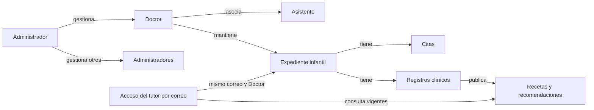

# Lilcare — Dominio de negocio vigente

**Revisión: 10 de octubre de 2026.** Describe el dominio confirmado en el código actual y las decisiones registradas; sustituye la propuesta inicial. No es un manual de usuario ni acredita pruebas funcionales con cuentas reales.

**Alcance:** actores, relaciones, acceso, expedientes, citas y documentos. Las irregularidades y su seguimiento se mantienen en [PENDIENTES.md](PENDIENTES.md). Los procedimientos detallados por rol están en los [contextos de operaciones](SHARED_OPERATIONS_CONTEXT.md).

**Certeza:** salvo indicación contraria, las reglas siguientes son **CONFIRMADAS en código**. Las cuestiones de negocio externas al repositorio se enumeran al final.

## 1. Actores y ámbitos

| Actor | Rol interno | Propósito y alcance | Entrada habitual |
| --- | --- | --- | --- |
| Administrador | `admin` | Gestiona Doctores y Administradores en directorios separados; consulta Bitácora. No hereda el calendario ni el expediente clínico del Doctor. | Login de personal → Doctores |
| Doctor | `doctor` | Gestiona sus pacientes, agenda, registros clínicos, vacunas, gráficas, documentos, impresión y asistentes. | Login de personal → Calendario |
| Asistente | `assistant` | Opera la agenda del Doctor asociado: agenda, reagenda y cancela; crea pacientes desde el formulario de cita y configura disponibilidad. No accede al historial clínico. | Login de personal → Calendario del Doctor asociado |
| Paciente / tutor en el portal | `patient` en la sesión autorizada del servidor | Consulta los niños asociados al correo de acceso, sus citas y documentos publicados vigentes. Puede reservar, reagendar y cancelar si lo permite el Doctor. | Acceso paciente → Calendario familiar |

`AppUser.role` contiene los tres roles del personal. El rol funcional Paciente se representa mediante la sesión del portal; no es una cuenta del personal en `users`.

### Paciente niño y padre/madre/tutor

- **Paciente** es el expediente del menor atendido, no una cuenta independiente del tutor.
- Quien utiliza normalmente el portal es el padre, madre o tutor. Esa interpretación funcional no prueba quién es legalmente responsable del menor.
- El expediente guarda nombre del padre, nombre de la madre, correo principal y correo secundario opcional, además de teléfonos de contacto. Los nombres no son identidades de acceso separadas.
- Tener dos campos de correo no constituye una regla de «máximo dos tutores legales». No se modela una lista de cuentas de tutores ni un vínculo mediante `patientUserId`.
- El teléfono es un dato de contacto; el acceso del portal usa correo y contraseña generada.

Fuentes:

- `src/app/core/models/user.ts`
- `src/app/app.routes.ts`
- `src/app/shared/components/sidebar/sidebar.ts`
- `functions/src/clinic-patients.ts`
- `src/app/core/services/auth.service.ts`

## 2. Personal: creación, asociación y permisos

### Administrador

- Navegación: **Doctores → Administradores → Bitácora**, en ese orden. Su entrada principal sigue siendo Doctores.
- Invita, edita y elimina Doctores y otros Administradores mediante operaciones autorizadas del servidor.
- No puede eliminarse a sí mismo ni eliminar al último Administrador habilitado que cumple las comprobaciones de autoridad del servidor. Una invitación pendiente no equivale a un Administrador habilitado.
- Desde su propio perfil puede cambiar **únicamente el correo**, no su nombre. Administrar otra cuenta es una operación distinta.
- La primera cuenta administrativa necesita preparación externa autorizada; no existe autorregistro público para obtener ese rol.

### Doctor

- Navegación: **Calendario, Pacientes, Asistentes, Impresión**.
- Gestiona los expedientes de su propio consultorio y sus registros clínicos.
- Invita y administra sus asistentes. No crea Administradores ni otros Doctores.
- Puede editar su perfil profesional y logo; cambiar su propio correo no está habilitado en su editor. El Administrador puede gestionar el correo del Doctor por el flujo autorizado.
- Es el único de estos roles que puede habilitar/deshabilitar **«Permitir que los pacientes agenden citas»**, consultar/copiar la contraseña de acceso de un paciente y regenerarla.

### Asistente

- Su asociación se guarda en `createdBy`; la agenda requiere que ese propietario sea un Doctor válido y habilitado.
- Puede crear un expediente básico desde una cita, seleccionar pacientes del directorio básico, agendar, reagendar, cancelar y modificar duración/segmentos de disponibilidad de su Doctor.
- No ve ni modifica el permiso «Permitir que los pacientes agenden citas»; el servidor también rechaza ese cambio.
- No consulta ni modifica antecedentes, medidas clínicas, diagnósticos, gráficas, vacunas, recomendaciones o recetas. Crear un paciente básico no le concede esas operaciones.
- No recibe la contraseña recién generada del paciente ni puede consultarla o renovarla. El acceso se trata de entregar a los correos de contacto.
- Puede editar su propio nombre y correo.
- **Excepción de pruebas acordada:** el backend admite que un Admin cree un Asistente asociado al propio Admin. No es una opción del directorio normal del Admin y ese Asistente no tiene agenda hasta asociarse a un Doctor válido. No implica permisos clínicos para el Admin.

### Acceso inicial del personal

Las invitaciones solicitan nombre y correo; el enlace permite establecer contraseña y completar el acceso. El Doctor completa datos profesionales; Admin y Asistente tienen una configuración inicial reducida. El personal utiliza Firebase Authentication y un perfil autorizado; un rol declarado solo en el frontend no concede permisos de servidor.

Fuentes:

- `functions/src/staff-invitations.ts`
- `functions/src/staff-deletion-policy.ts`
- `functions/src/staff-deletion.ts`
- `functions/src/staff-email-change.ts`
- `functions/src/clinic-operations.ts`
- `src/app/pages/setup-profile/setup-profile.ts`
- `src/app/shared/components/profile-dialog/profile-dialog.ts`
- `src/app/pages/calendar/calendar.ts`

## 3. Acceso familiar del Paciente

### Correo y contraseña generada

1. El Doctor, o su Asistente desde una cita, registra al menor con sus contactos.
2. El servidor genera una contraseña aleatoria de **seis caracteres**, única entre las credenciales activas reservadas por el sistema; no se deriva del nombre del niño y no se elige manualmente.
3. El sistema trata de enviar el acceso a ambos correos guardados, sin duplicar el envío si coinciden. Un fallo de entrega no revierte el alta del expediente.
4. El tutor entra en **Acceso paciente** (`/patient-login`) con un correo registrado y una contraseña vigente.
5. El servidor valida ese acceso y entrega una sesión que identifica el expediente utilizado y el Doctor correspondiente.

La palabra **OTP** es una denominación interna histórica. La contraseña **no es de un solo uso**, no se consume al entrar ni caduca por tiempo: se reutiliza hasta su renovación por el Doctor. Renovarla invalida las sesiones ligadas a la credencial anterior. El portal no ofrece autorregistro, elección de contraseña, cambio autónomo ni recuperación propia mediante «Olvidé mi contraseña».

### Grupo de niños asociado al acceso

- El grupo se obtiene por el **correo utilizado para entrar**, presente como correo principal o secundario, y el **mismo Doctor** del expediente que validó la contraseña.
- Entrar con la contraseña de un niño puede permitir consultar hermanos que compartan ese correo y Doctor.
- Cada expediente conserva su propia credencial; no hay una contraseña única de familia definida como entidad independiente.
- Compartir solo un apellido, teléfono o nombre de padre/madre no incorpora niños al grupo.
- El mismo correo en distintos consultorios no mezcla expedientes ni ofrece un selector libre de Doctores.

### Sesión del portal

- **Sin cuentas, inicio de sesión ni tokens de Firebase Authentication para pacientes.** La autorización del portal la valida el servidor mediante su sesión propia.
- El cliente conserva el acceso **únicamente en memoria del servicio**: no lo persiste en cookies, `localStorage` ni `sessionStorage`.
- Recargar o cerrar la pestaña exige volver a introducir correo y contraseña. Una pestaña que permanece abierta conserva el acceso mientras siga válido.
- El máximo es **una hora de inactividad**. Las interacciones del usuario renuevan el plazo; recibir actualizaciones no cuenta como actividad.
- Cerrar sesión o vencer el plazo retorna a Acceso paciente. Terminar la sesión no elimina el expediente ni consume la contraseña.

Fuentes:

- `functions/src/patient-credentials.ts`
- `functions/src/clinic-patients.ts`
- `functions/src/clinic-auth.ts`
- `functions/src/clinic-patient-token.ts`
- `functions/src/clinic-leases.ts`
- `functions/src/clinic-patient-portal.ts`
- `src/app/core/services/auth.service.ts`
- `src/app/core/services/clinic-gateway.service.ts`
- `src/app/core/repositories/patient.repository.ts`

## 4. Entidades y relaciones

El Doctor es el propietario del ámbito asistencial. Un registro infantil corresponde a un Doctor; las citas y los registros clínicos conservan ese ámbito. No se modela un único expediente global compartido automáticamente por todos los Doctores.

### Modelo lógico implementado

| Entidad | Representación principal | Datos y relaciones relevantes |
| --- | --- | --- |
| Personal | `users`; modelo `AppUser` | ID de perfil `uid`, identidad Auth asociada `firebaseUid`, rol, nombre, correo, estado pendiente/completo. `createdBy` asocia al Asistente con su propietario. |
| Paciente infantil | `patients`; modelo `Patient` | ID del expediente, `doctorId`, nombre/apellidos, nacimiento, contactos y nombres de padres; antecedentes, medidas de nacimiento y `vaccinationRecord` cuando el Doctor los registra. |
| Directorio básico de pacientes | `patientDirectory` | Datos básicos para operaciones de agenda del personal autorizado; no equivale al expediente clínico completo. |
| Resumen familiar del portal | `patientPortal` | Información mínima de identificación y contactos necesaria para el acceso autorizado del portal. No es una cuenta de tutor. |
| Cita | `appointments`; modelo `Appointment` | ID, `patientId`, `doctorId`, día, hora, motivo, estado/tipo y datos de identificación/contacto guardados en la cita. |
| Registro clínico | `clinicalRecords`; modelo `ClinicalRecord` y ámbito añadido por servidor | `patientId`, `doctorId`, fecha, medidas, motivo clínico, diagnóstico, notas, recomendaciones/receta, vigencias y autoría. |
| Documento publicado | `patientDocuments` | Derivado de un registro clínico: paciente, Doctor, registro de origen, tipo de documento, contenido y vigencia. No publica el registro clínico completo. |
| Disponibilidad | Campos del Doctor en `users`, con representaciones de servidor en `schedules` y `doctorProfiles` | Duración, segmentos semanales y permiso de reservas del Paciente. No constituye una cita. |
| Credencial del Paciente | `patientCredentials`, gestionada exclusivamente por servidor | Asociada al expediente y sus correos; contraseña cifrada, revisión y reserva de unicidad. No se incluye en resúmenes accesibles al Asistente o al portal. |
| Sesión autorizada | `clinicSessions`, gestionada por servidor | Autoriza temporalmente un ámbito y controla su actividad/revocación. La sesión del Paciente no representa una cuenta Auth. |

No existe en el modelo operativo descrito una entidad independiente `patient_users`, un `username` telefónico ni una lista `tutores: [userId...]` que determine el acceso familiar.

Fuentes:

- `src/app/core/models/user.ts`
- `src/app/core/models/clinical-record.ts`
- `src/app/core/repositories/patient.repository.ts`
- `src/app/core/repositories/clinical-record.repository.ts`
- `functions/src/clinic-data.ts`
- `functions/src/clinic-patients.ts`
- `functions/src/clinic-operations.ts`
- `functions/src/patient-credentials.ts`

## 5. Citas y disponibilidad

### Cita versus atención clínica

Una **cita** es una reserva o entrada de agenda. Un **registro clínico** contiene datos de atención del niño. Comparten paciente y ámbito del Doctor, pero el modelo no define un vínculo obligatorio uno a uno mediante `appointmentId` en el registro clínico. Agendar no crea por sí solo diagnóstico, medidas, receta ni recomendaciones.

- Estados de cita: `scheduled` (agendada), `attended` (atendida) y `cancelled` (cancelada).
- Tipos: `scheduled` (programada) y `walk-in` (sin cita previa).
- `disabled` permite excluir una cita deshabilitada. Canceladas y deshabilitadas no ocupan un horario para nuevas reservas.
- El Paciente solo opera sus reservas familiares autorizadas; no puede marcar una atención clínica ni crear un expediente.

### Quién puede reservar

Doctor y Asistente operan la agenda del Doctor asociado. El Paciente puede **agendar, reagendar y cancelar** cuando `allowPatientScheduling` está habilitado. Deshabilitarlo también impide la cancelación autónoma del portal; el tutor necesita gestionar esas operaciones con el consultorio. No elimina las citas existentes ni impide consultar sus documentos vigentes.

Las reservas se registran directamente; no tienen un paso posterior de aprobación. Una reserva del portal aparece en la misma agenda que utiliza el consultorio.

### Reglas de día y hora

- Referencia horaria del consultorio: **`America/Mexico_City`**, hora del centro de México.
- Día de cita: fecha civil `YYYY-MM-DD`; hora: `HH:mm`. No se deben interpretar como fecha/hora UTC del dispositivo.
- La disponibilidad semanal usa segmentos Inicio/Fin por día y duración de consulta. La consulta debe caber completa y su inicio coincidir con los intervalos generados desde el comienzo del segmento.
- Fin `00:00` significa final del día. Se permiten varios segmentos y toda la semana cerrada. Cerrar disponibilidad no cancela citas existentes.
- Para una nueva fecha/hora no se permiten días pasados ni cerrados; hoy solo ofrece horas posteriores al minuto actual del consultorio.
- **Ajuste local P53:** hoy permanece seleccionable si tiene segmentos abiertos, aunque ya no haya horas futuras. Esto no permite guardar una nueva hora pasada. El ajuste está verificado localmente, todavía sin publicar.
- Al cambiar de día, una hora que deja de ser válida se limpia. Guardar vuelve a comprobar la disponibilidad temporal.
- En una cita vigente puede conservarse la fecha/hora original y cambiar solo motivo, incluso si pasó o cambió la disponibilidad. Su propia cita no cuenta como ocupación; para el Paciente, otra cita vigente a esa hora sí impide conservarla.
- El Paciente no puede elegir un horario ocupado. El personal mantiene la posibilidad de superponer citas con advertencia; no se presenta la agenda como garantía de exclusividad absoluta.

### Actualizaciones

Las citas se actualizan en tiempo real: Doctor/Asistente mediante listeners y Paciente mediante streaming del servidor. La configuración de horarios se carga al entrar al calendario; el usuario aceptó conservar ese comportamiento sin añadir sincronización en vivo de esa configuración entre sesiones.

Fuentes:

- `src/app/pages/calendar/calendar.ts`
- `src/app/pages/calendar/dialogs/appointment-dialog/appointment-dialog.ts`
- `src/app/pages/calendar/dialogs/settings-dialog/settings-dialog.ts`
- `src/app/core/utils/availability.ts`
- `src/app/core/utils/clinic-time.ts`
- `src/app/core/repositories/appointment.repository.ts`
- `functions/src/clinic-data.ts`
- `functions/src/clinic-operations.ts`
- `functions/src/clinic-patient-portal.ts`
- `PENDIENTES.md` — P19, P20, P21, P25, P28 y P53

## 6. Expediente, publicaciones e impresión

- El Doctor mantiene antecedentes, registros por consulta, peso, talla, circunferencia, otras medidas, gráficas y esquema de vacunación.
- El Asistente y el Paciente no acceden a ese historial clínico completo.
- **«Ver historial» en el portal** significa consultar recomendaciones y recetas publicadas vigentes, no abrir la vista clínica del Doctor.
- Recomendaciones y recetas tienen fechas de visibilidad independientes. La fecha límite incluye ese día en el horario del consultorio; documentos sin fecha límite se consideran visibles.
- El portal muestra **todos los documentos vigentes**, incluidos varios del mismo tipo y día. Ordena por día de consulta descendente y creación original dentro del día; editar un documento anterior no lo desplaza por encima de uno creado después.
- El tutor puede imprimir cada documento disponible. No edita contenido ni amplía vigencia.
- La impresión profesional del Doctor usa sus ajustes de papel, orientación, márgenes, campos y logo personalizado. La impresión del portal usa Carta vertical con márgenes de 2.5 cm y no incorpora el encabezado profesional ni logo del Doctor.

Fuentes:

- `src/app/core/models/clinical-record.ts`
- `src/app/core/models/print-settings.ts`
- `src/app/pages/patient-history/patient-history.ts`
- `src/app/pages/patient-history-view/patient-history-view.ts`
- `src/app/core/utils/clinical-record-order.ts`
- `src/app/pages/impresion/impresion.ts`
- `functions/src/clinic-operations.ts`

## 7. Información no determinable desde el código

- Cómo se comprueba la identidad y autorización legal de quien usa los correos del menor.
- Qué canal debe usar el tutor para recuperar acceso, renovar documentos o gestionar citas cuando el portal no permite reservar.
- Qué anticipación, cargos o límites de reservas debe comunicar el consultorio, además de las validaciones implementadas.
- Qué política organizacional se aplica cuando una familia es atendida por varios Doctores; el portal actual mantiene los ámbitos separados.

Estos aspectos necesitan definición del consultorio; no se convierten en reglas implementadas por aparecer como preguntas.
